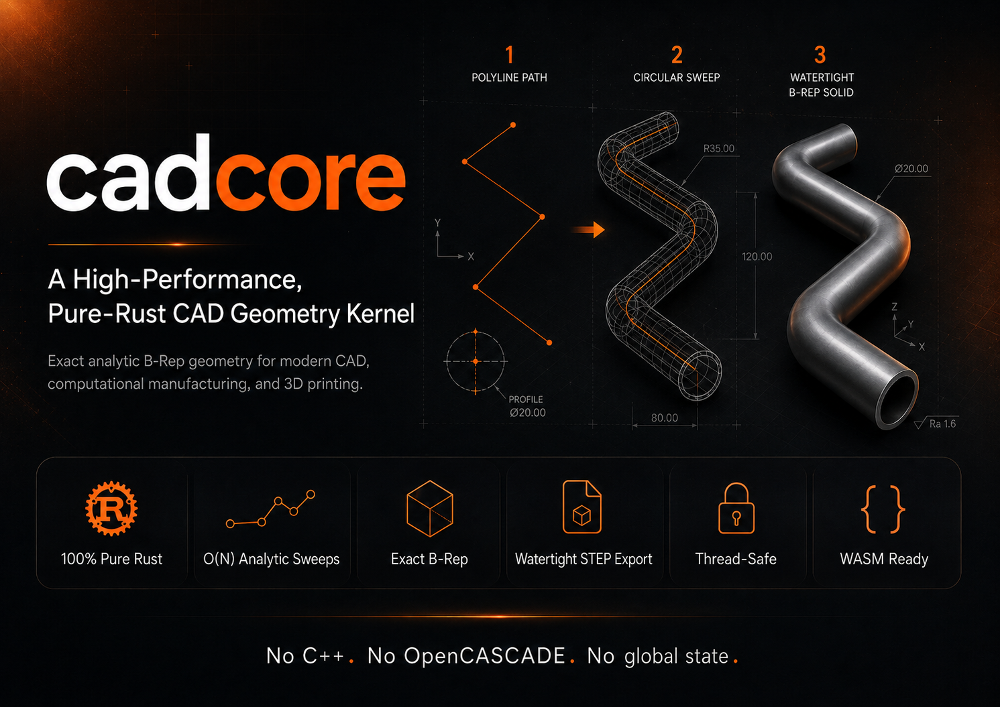

# cadcore



**A High-Performance, Pure-Rust CAD Geometry Kernel.**

[](https://opensource.org/licenses/MIT)
[](https://www.rust-lang.org/)
[](https://crates.io/crates/cadcore)

`cadcore` is a lightweight, mathematically exact 3D CAD geometry kernel written from the ground up in pure Rust. It is designed to replace heavy C++ legacy kernels (like OpenCASCADE) in modern engineering pipelines, computational manufacturing, and 3D printing.

**Zero C++ dependencies. No OpenCASCADE. No global state. Fully thread-safe & parallelizable.**

---

## Why cadcore?

### 🚀 1. Zero C++ Pain (Pure Rust)
Most CAD kernels in Rust are unsafe FFI bindings to 200MB+ C++ libraries. `cadcore` is 100% Rust. It compiles in seconds, has a binary footprint under 1MB, cross-compiles to any target, and runs natively in **WebAssembly (WASM)** for browser-side CAD.

### ⚡ 2. $O(N)$ Sweep Complexity (The OpenCASCADE Killer)
In traditional CAD kernels, sweeping a circular profile along a toolpath with thousands of lines requires expensive Boolean union operations ($O(N^2)$ complexity) that freeze the CPU or fail on self-intersections. `cadcore` uses a custom analytic sweep solver to build exact B-Rep solids directly in **linear $O(N)$ time** without a single Boolean union.

### 📐 3. Mathematically Watertight
`cadcore` represents 3D shapes using exact analytic surfaces (Planes, Cylinders, Spheres, Tori) and curves (Lines, Circles, Ellipses). There are no mesh approximations or chordal deviation errors in the kernel. Corner joins are smoothly blended with G1-smooth torus fillets or exact miter planes.

### 🔒 4. Modern, Safe B-Rep Topology
We replace C-style raw pointers with an arena-based B-Rep topology using typed stable IDs (`slotmap`). The Rust compiler prevents logic bugs at compile-time (e.g., passing a `FaceId` where an `EdgeId` is expected), and memory is managed safely without segmentation faults.

### 📁 5. Direct, High-Precision STEP Export
Generate industry-standard, high-precision STEP AP203/AP214 files directly from memory without temporary files. The exported files are watertight, manifold closed shells that open flawlessly in **SolidWorks, Autodesk Inventor, Fusion 360, FreeCAD, Rhino, and CATIA**.

---

## Use Cases

*   **3D Printing & Slicing:** Building exact mathematical models from G-code or toolpaths for validation and simulation.
*   **Computational Design:** Generating complex lattice structures, gyroids, and structural frames.
*   **Bioprinting Scaffolds:** Designing micro-channel networks and bio-compatible scaffolds with precise filament sweeping.
*   **WASM CAD Tools:** Building lightweight, browser-based CAD designers and configurators without backend rendering.

---

## Quick Start

Add `cadcore` to your `Cargo.toml`:

```toml
[dependencies]
cadcore = "0.2.4"
```

Create a watertight U-shaped filament rod and export it to a STEP file:

```rust
use cadcore::{
    math::Point3,
    topo::BRep,
    ops::{sweep_circle_along_polyline, SweepOptions},
    step::brep_to_step,
};

fn main() -> Result<(), Box<dyn std::error::Error>> {
    // 1. Define a U-shaped filament center-line
    let waypoints = vec![
        Point3::new( 0.0, 0.0, 0.0),
        Point3::new(10.0, 0.0, 0.0),
        Point3::new(10.0, 8.0, 0.0),
        Point3::new( 0.0, 8.0, 0.0),
    ];

    // 2. Initialize the B-Rep database
    let mut brep = BRep::new();

    // 3. Sweep a circle of radius 0.25mm along the path (inserts torus corner fillets)
    let opts = SweepOptions {
        fillet_corners: true,
        corner_fillet_radius: 0.0, // defaults to profile radius
        name: Some("filament_loop".to_string()),
    };
    sweep_circle_along_polyline(&mut brep, &waypoints, 0.25, &opts)?;

    // 4. Export to a watertight STEP file
    let step_content = brep_to_step(&brep)?;
    std::fs::write("filament.step", &step_content)?;

    println!("Watertight STEP model successfully written to filament.step!");
    Ok(())
}
```

### 🧩 6. Native Booleans: Fuse and Planar Cut
`cadcore-union` fuses any number of swept filaments (straight legs, torus elbows, flat end caps) into **one watertight solid** and trims the result with planes — in pure Rust, with no external kernel.

* **Universal fuse** (`union::fuse_filaments_with`) — a true Boolean union: crossings, free ends under a row, parallel connectors, T-junctions. Every intersection curve is traced once and imprinted on both faces, so shared edges are identical by construction.
* **Planar cut** (`union::half_space_cut`) — trims an already-fused solid with a half-space and closes it with planar section caps; it cuts through legs, elbows and junction rims alike.
* **Robust cut** (`union::half_space_cut_robust`, `union::trim_shell`) — a trim plane taken from the part's own dimensions often grazes a junction rim or an end cap within microns. The robust cut moves the plane by 10–40 µm when the exact position has no closed result and reports the shift, so mating parts can follow.
* **CAD-friendly faces** — every tube face is written as two half faces bounded by real ruling-line edges (no periodic seam for the importer to invent), with exact circles and lines wherever the geometry is one.

Verified on orthogonal-grid, diamond and honeycomb lattices: each fused-and-trimmed export is a single closed manifold solid in **Ansys SpaceClaim** and in OpenCASCADE-based readers (FreeCAD), its volume matches an independent point-sampling reference to 0.01 %, and it meshes and solves in Ansys Maxwell together with separately exported electrode plates.

```rust
use cadcore::geom::Plane3;
use cadcore::math::{Point3, UnitVec3};
use cadcore::union::{fuse_and_trim, Filament, FuseOptions};

// one filament per printed path: straight legs joined by constant-radius elbows
let filaments: Vec<Filament> = paths
    .iter()
    .map(|pts| Filament::serpentine(pts, 0.275, 0.5))
    .collect();

// keep 1 mm <= y <= 5 mm
let planes = [
    Plane3::from_origin_normal(Point3::new(0.0, 1.0, 0.0), UnitVec3::Y),
    Plane3::from_origin_normal(Point3::new(0.0, 5.0, 0.0), -UnitVec3::Y),
];
let part = fuse_and_trim(&filaments, &FuseOptions::default(), &planes, 1.0e-6);
assert!(part.is_watertight());
for t in &part.trims {
    println!("cut plane moved by {} mm, {} caps", t.shift, t.caps);
}
let step = cadcore::step::brep_to_step(&part.brep)?;
```

The stages are public too — `fuse_filaments_with`, `trim_shell`, `half_space_cut_robust`, `merge_shell_edges`, `validate_shell` — all re-exported from `cadcore::union`.

### 🔺 7. One Solid, Every Consumer
The exact model is the single source of geometry; everything downstream asks the kernel.

* **Triangles** — `mesh::mesh_brep` turns any kernel B-Rep (trimmed half faces, section caps, plates) into per-face triangle meshes to a chord tolerance; `mesh::import_step` does the same for a STEP file written by another CAD system, and `mesh::section_outline` gives the closed outline a plane cuts out of a solid.
* **Volume meshing** — `union::LatticeModel` is the point-membership form of the solid `fuse_and_trim` builds: exact tubes, flat trim planes. A voxel or tetrahedral mesher that asks it "is this point material?" meshes the same solid the STEP export describes. A DC-conduction solve on a voxel mesh of this model agrees with Ansys Maxwell solving the exported STEP to 2 %.

```rust
use cadcore::mesh::{mesh_brep, ImportOptions};
use cadcore::union::LatticeModel;

let (faces, _report) = mesh_brep(&part.brep, &ImportOptions::default())?;   // for display
let model = LatticeModel::for_trims(&filaments, &part.trims);              // for meshing
assert!(model.contains(some_point_inside));
```

---

## Status

What the kernel does today, and what it was checked against.

| Capability | State |
|---|---|
| Filament sweep (cylinders, torus elbows, miter joints, caps), boxes, rounded plates | stable |
| STEP AP214 export | stable — every edge shared by exactly two faces; read as closed solids by Ansys SpaceClaim and OpenCASCADE (FreeCAD) |
| Lattice fuse + planar trim (`union::fuse_and_trim`) | stable on orthogonal-grid, diamond and honeycomb lattices; volume within 0.01 % of a sampling reference; solved in Ansys Maxwell |
| Solid membership for meshers (`union::LatticeModel`) | stable — a voxel conduction solve on it agrees with Maxwell on the exported STEP to 2 % |
| Tessellation and STEP import (`mesh::mesh_brep`, `mesh::import_step`) | stable |
| Union of analytic solids (`union::boolean::union_n`) | boxes, cylinders, swept filaments, coaxial tori |

Known limits:

* an elbow needs a bend radius larger than the tube radius;
* two filaments ending flush in one plane are not united with each other, and a filament is not fused with itself — both are reported by the fuse (`FuseReport`), never silent;
* `union_n` does not handle two tori crossing transversally;
* SolidWorks import has not been re-verified for the 0.2 half-face export (SpaceClaim, FreeCAD and Maxwell have).

Every public operation is covered by tests; the suite has no ignored or failing tests.

---

## Crate Architecture

The kernel is split into eight crates:

```
cadcore/
├── crates/
│   ├── cadcore-math    — Points, vectors, matrices, rigid transforms (zero deps)
│   ├── cadcore-geom    — Exact analytic curves and surfaces
│   ├── cadcore-topo    — Arena B-Rep database: Solid → Shell → Face → Loop → Edge
│   ├── cadcore-ops     — High-level sweep and trimming operations
│   ├── cadcore-union   — Booleans: universal filament fuse, planar cut, validation gates
│   ├── cadcore-mesh    — Tessellation, STEP import, plane sections (B-Rep → triangles)
│   ├── cadcore-step    — Watertight STEP AP203/AP214 writer
│   └── cadcore         — Facade crate re-exporting everything under a single namespace
```

### Dependency Flow

```
cadcore-math (no deps)
     ↑
cadcore-geom
     ↑
cadcore-topo
     ↑
cadcore-union ──→ cadcore-ops
     ↑                 ↑
cadcore-step ←─────────┤
     ↑                 │
cadcore-mesh      cadcore (facade: math, geom, topo, ops, union, step, mesh)
```

---

## Comparison: cadcore vs. OpenCASCADE (OCCT)

| Feature | OpenCASCADE (OCCT) | cadcore |
|---|---|---|
| **Language** | C++ (requires FFI bindings) | 100% Pure Rust |
| **Safety** | Raw pointers, potential segfaults | Compile-time ID safety, safe memory |
| **Performance** | $O(N^2)$ Boolean unions for sweeps | **$O(N)$ analytic sweeps** |
| **Binary Footprint** | ~200 MB prebuilt libraries | **< 1 MB** |
| **WASM Support** | Emscripten (large, complex WASM bloat) | **Native WASM target** |
| **Setup & Build** | Painful multi-step C++ toolchain | `cargo add cadcore` in seconds |

---

## License

All cadcore workspace crates are available under the **MIT License**,
including earlier published releases. Commercial and non-commercial use are
permitted under the terms of [LICENSE](LICENSE).

Versions 0.1.0-0.1.21 were originally published under
PolyForm-Noncommercial-1.0.0; version 0.1.22 was the first published with MIT
metadata. The copyright holder has additionally licensed those earlier releases
under MIT. Their existing crates.io archives and historical metadata are
unchanged (0.1.0 is displayed as `non-standard`). See the explicit
[MIT grant for earlier releases and licensing history](LICENSE-HISTORY.md),
which you can retain with an older release as evidence of this permission.

Third-party dependencies retain their own licenses; this grant covers cadcore's
code, not third-party code.

---

## Contributions & Support

Contributions, bug reports, and pull requests are welcome! If you have questions, want to discuss integration into your CAD/CAM pipeline, or have commercial/partnership queries, feel free to reach out to Dmytro Yatskovskyi at [dmytroyatskovskyi@outlook.com](mailto:dmytroyatskovskyi@outlook.com) or open an issue/pull request in the [GitHub Repository](https://github.com/YATSKOVSKYI/cadcore).
